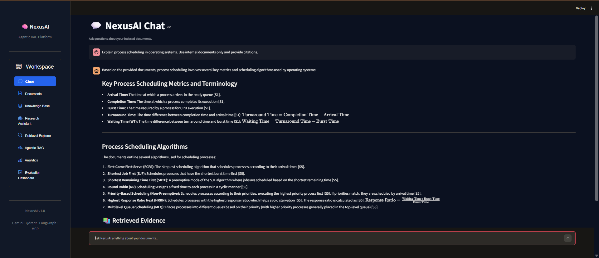
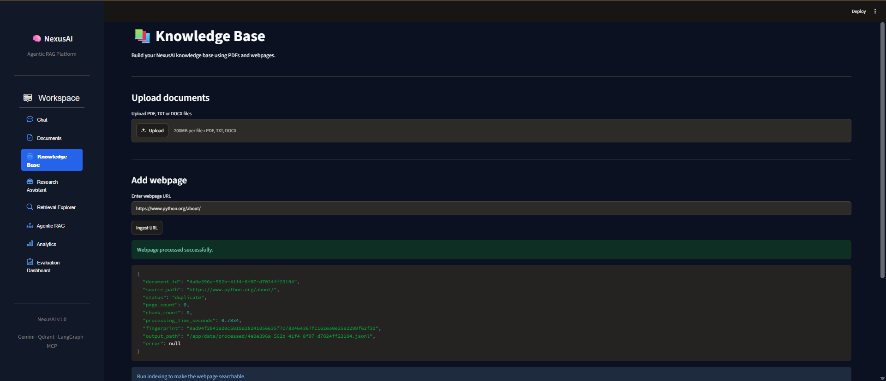
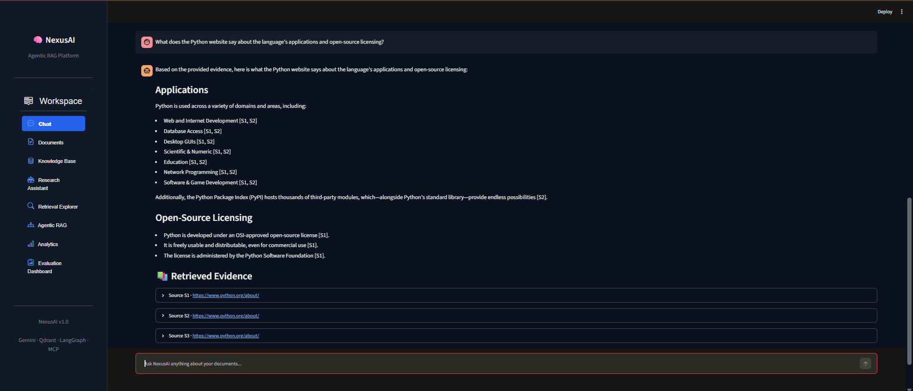
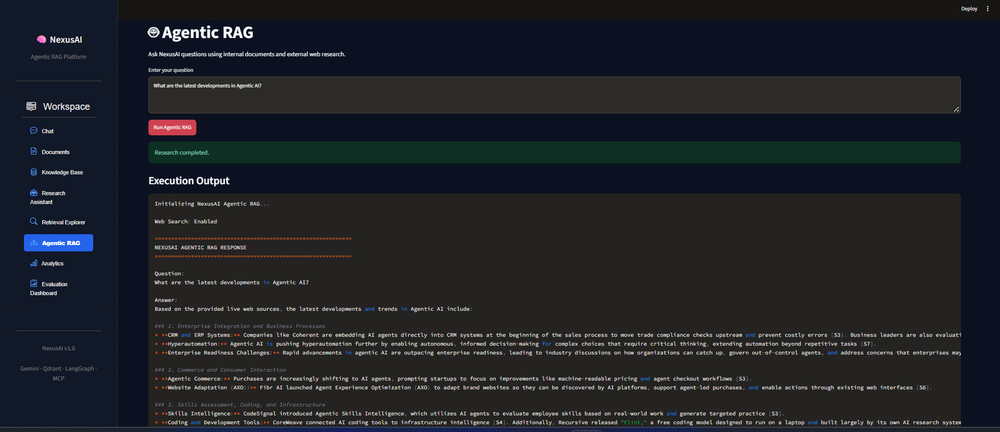
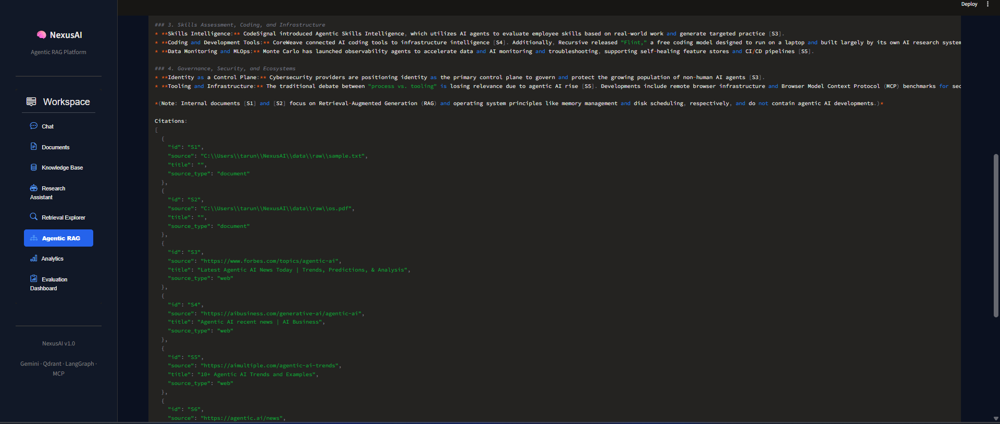
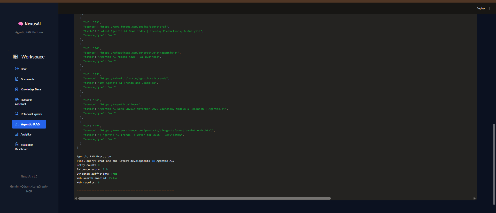
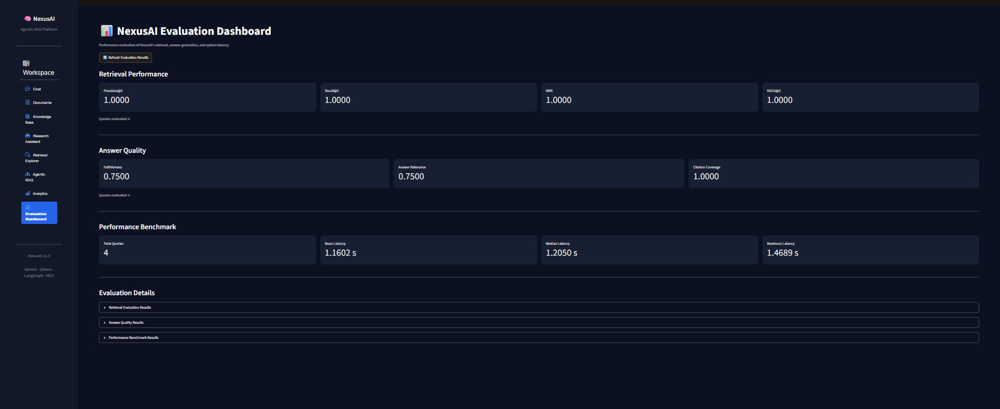

# NexusAI — Agentic RAG Platform

An end-to-end Agentic Retrieval-Augmented Generation (RAG) platform combining hybrid search, semantic retrieval, reranking, multi-source ingestion, web search, and evaluation into a containerized AI application.

NexusAI allows users to upload documents, ingest web pages, query their knowledge base, and obtain context-grounded responses with source citations. Its agentic workflow can determine when external web search is needed and combine information from internal documents and web sources.

## Key Features

### 1. Multi-Source Document Ingestion
- PDF, DOCX, and TXT document processing.
- Webpage ingestion through URLs.
- Text extraction and cleaning.
- Recursive character-based chunking.
- SHA-256 fingerprinting and duplicate detection.
- Metadata enrichment and JSONL persistence.

### 2. Embedding Generation and Vector Storage
- Gemini embedding generation.
- 768-dimensional embeddings.
- Qdrant vector database integration.
- Persistent vector storage.

### 3. Hybrid Retrieval Pipeline
- Dense semantic retrieval.
- BM25 keyword-based retrieval.
- Reciprocal Rank Fusion (RRF).
- BGE-based cross-encoder reranking.
- Context selection for answer generation.

### 4. Agentic RAG
- LangGraph-based agent workflow.
- Query analysis and classification.
- Internal knowledge-base retrieval.
- Evidence grading.
- Query rewriting and retrieval retries.
- Context-grounded answer generation.
- Source citations.

### 5. Web Search Integration
- Tavily-powered web search.
- External webpage reading.
- Web results integrated into the agentic workflow.
- Combined internal-document and external-web evidence.

### 6. MCP Server
NexusAI exposes capabilities through a Model Context Protocol (MCP) server.

Available tools include:
- `search_documents`
- `ask_nexusai`
- `list_documents`
- `get_document_details`
- `search_web`
- `read_webpage`

### 7. Evaluation and Observability
- Retrieval evaluation.
- Answer-quality evaluation.
- Faithfulness and answer-relevance metrics.
- Citation coverage.
- Retrieval performance benchmarking.
- Latency measurements.
- MLflow experiment tracking.

### 8. Interactive Dashboard
A Streamlit application providing:
- Chat interface.
- Document management.
- Knowledge-base ingestion.
- Research assistant.
- Retrieval explorer.
- Agentic RAG interface.
- Analytics dashboard.
- Evaluation dashboard.

## Architecture

```text
                  USER
                   |
                   v
             STREAMLIT UI
                   |
          +--------+--------+
          |                 |
          v                 v
    DOCUMENT INGESTION   AGENTIC RAG
          |                 |
          v                 v
     Text Extraction    Query Analysis
          |                 |
          v                 v
      Text Cleaning    Hybrid Retrieval
          |                 |
          v          +------+------+
      Chunking       |             |
          |          v             v
          v       QDRANT         BM25
    Embeddings        |             |
          |          +------+------+
          v                 |
       QDRANT               v
                    Reciprocal Rank Fusion
                             |
                             v
                       BGE Reranker
                             |
                             v
                       Evidence Grading
                             |
                    +--------+--------+
                    |                 |
                    v                 v
               Internal KB       Tavily Web
                    |                 |
                    +--------+--------+
                             |
                             v
                     Answer Generation
                             |
                             v
                       Source Citations
                             |
                             v
                          USER
```

## Technology Stack

| Category | Technologies |
|---|---|
| Language | Python |
| LLM and Embeddings | Google Gemini |
| Agent Framework | LangGraph |
| Retrieval | BM25, Dense Retrieval, RRF |
| Reranking | BGE Cross-Encoder |
| Vector Database | Qdrant |
| Web Search | Tavily |
| Protocol | Model Context Protocol (MCP) |
| Evaluation | Custom Evaluation Pipeline, MLflow |
| Frontend | Streamlit |
| Containerization | Docker, Docker Compose |
| Testing | Pytest |

## Project Structure

```text
NexusAI/
│
├── data/
│   ├── evaluation/
│   ├── raw/
│   ├── processed/
│   └── sample_documents/
│
├── docs/
│
├── frontend/
│   ├── components/
│   ├── views/
│   ├── app.py
│   └── config.py
│
├── scripts/
│   ├── index_documents.py
│   ├── ingest_documents.py
│   ├── run_agentic_rag.py
│   ├── evaluate_retrieval.py
│   ├── evaluate_answers.py
│   └── benchmark_retrieval.py
│
├── src/nexusai/
│   ├── agentic/
│   ├── embeddings/
│   ├── evaluation/
│   ├── ingestion/
│   ├── mcp_server/
│   ├── observability/
│   ├── reranking/
│   ├── retrieval/
│   └── vectorstore/
│
├── tests/
│   ├── unit/
│   ├── integration/
│   └── evaluation/
│
├── .env.example
├── .gitignore
├── docker-compose.yml
├── Dockerfile
└── requirements.txt


```
## 📸 Application Screenshots

### 1. Internal Document Chat
Ask questions about indexed documents using Retrieval-Augmented Generation (RAG), with evidence-based answers and citations.



### 2. Knowledge Base & URL Ingestion
Upload PDF, TXT, and DOCX documents or ingest webpages directly into the knowledge base.



### 3. Webpage-Based Question Answering
Retrieve and use indexed webpage content to generate answers with source citations.



### 4. Agentic RAG Research
Use an agentic workflow to determine whether a query requires internal retrieval or external web research.



### 5. Evidence & Source Citations
View the evidence used to generate answers, including internal documents and external web sources.



### 6. Agentic RAG Execution Metrics
Inspect query rewriting, evidence sufficiency, retry count, and web retrieval results.



### 7. Evaluation Dashboard
Monitor retrieval quality, answer quality, and system performance through evaluation metrics.



## Getting Started

### Prerequisites

- Docker Desktop
- Google Gemini API key
- Tavily API key (for web search functionality)

### 1. Clone the Repository

```bash
git clone https://github.com/YOUR_USERNAME/NexusAI.git
cd NexusAI
```

### 2. Configure Environment Variables

Create a `.env` file using the provided example:

```bash
copy .env.example .env
```

Add your API keys:

```dotenv
GEMINI_API_KEY=your_gemini_api_key
TAVILY_API_KEY=your_tavily_api_key
```

Configure the remaining variables using `.env.example`.

### 3. Start NexusAI

```bash
docker compose up --build -d
```

### 4. Access the Application

| Service | URL |
|---|---|
| NexusAI Dashboard | http://localhost:8501 |
| Qdrant Dashboard | http://localhost:6333/dashboard |

### 5. Ingest Documents

Place supported documents in `data/raw/`, or upload them through the application.

For URL ingestion, use the Knowledge Base interface.

To index processed documents:

```bash
docker compose exec nexusai python scripts/index_documents.py
```

### 6. Run Agentic RAG from the CLI

```bash
docker compose exec nexusai python scripts/run_agentic_rag.py --query "Explain Retrieval Augmented Generation."
```

## Evaluation

NexusAI includes separate evaluation workflows for retrieval quality, generated-answer quality, and retrieval latency.

Example commands:

```bash
docker compose exec nexusai python scripts/evaluate_retrieval.py

docker compose exec nexusai python scripts/evaluate_answers.py

docker compose exec nexusai python scripts/benchmark_retrieval.py
```

Evaluation results are available through the Streamlit Evaluation Dashboard.

## MCP Integration

NexusAI provides an MCP server that exposes document retrieval, agentic question answering, document management, and web search capabilities.

The server can be connected to compatible MCP clients using a standard stdio configuration.

Example VS Code configuration is available through the project's MCP setup instructions.

## Configuration and Data Persistence

Docker Compose uses named volumes for persistent Qdrant and MLflow data.

Local document directories are mounted into the application container.

API keys and private configuration must be supplied through environment variables and must never be committed to version control.

## Future Improvements

- OCR-based document processing.
- Advanced table and image extraction.
- More sophisticated semantic chunking.
- Expanded evaluation datasets and experiments.
- Additional MCP tools and integrations.
- Cloud deployment and scalable infrastructure.

## License

This project is currently available for educational and portfolio demonstration purposes. A formal open-source license can be added separately.
